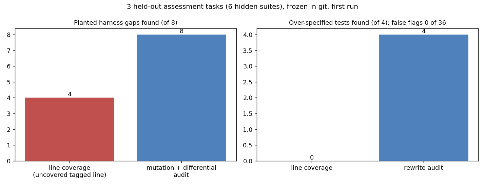

# Harness audit for generated coding assessments

> Unofficial prototype by Kushagra Pratap Singh. Not affiliated with Litmus.

## The problem
[Litmus](https://litmushiring.com/) generates every work trial "from scratch for your company" ([launch post](https://www.ycombinator.com/launches/RJe-litmus-the-industry-s-most-accurate-engineering-interview)). Each submission "runs in a live sandbox against a deterministic harness for correctness", and LLM graders score process and architecture.

A newly generated harness can be wrong in two directions, and no past candidate has tested it yet:
- **Too weak (false pass):** a candidate with a subtle bug passes, e.g. an off-by-one at the window edge, or returning `None` where the spec says `False`. Line coverage doesn't catch this: the line runs, but nothing checks the result.
- **Over-specified (false fail):** a correct candidate who wrote the code differently fails, because a test reads a private attribute, checks the exact text of an error message, or expects one order for an unordered result. Candidates "work in their own setup with their usual AI tools", so different-but-correct code is the normal case.

## What I built
`harnessaudit/` (stdlib Python) takes a task's reference solution, its hidden test suite and a small spec: an input generator plus what counts as equal (unordered results are compared sorted; exceptions by type).
- **GAP:** AST mutants of the reference are run against the suite, each in its own subprocess with a timeout:
  - mutation types: boundary flips, arithmetic swaps, ±1 constants, `and`↔`or`, dropped `not` / `-` / `.lower()`, `max`/`min` argument drops, `return None`, deleted statements;
  - every mutant that survives is checked against the reference on 300 random inputs;
  - if it really behaves differently, it's reported with the smallest input that shows it (automatically shrunk) and both outputs;
  - if no difference is found, it's counted as equivalent and **not** reported.
- **OVER_SPECIFIED:** the suite is also run on three rewrites of the reference that keep its behaviour: private names renamed, error messages reworded, unordered results reversed. Each rewrite is first checked to behave the same as the reference. Any test that fails on a rewrite is named, with the reason.
- **Kill rate** and **line coverage** (the baseline).

```
$ python demo.py        (tasks/dev/rate_limiter/tests_weak.py)
  line coverage of the reference: 100%
  GAP: a submission with this bug passes every hidden test
    line 18: `return False`  [return None]
      input (1, 4, [('allow', 'a', 2), ('allow', 'a', 2)])
      reference -> [('ok', True), ('ok', False)]
      buggy     -> [('ok', True), ('ok', None)]
    line 24: `return max(0, self.limit - len(self._recent(user, now)))`  [0 -> 1]
      input (1, 1, [('allow', 'b', 5), ('remaining', 'b', 5)])   reference -> 0, buggy -> 1
  OVER_SPECIFIED: fails a correct solution that is written differently
    test_active_users: asserts an order the spec leaves open
    test_hits_stored: uses a private name (attribute or helper starting with _) that a correct solution may not have
```

## Results: held-out
Each task has a reference solution, a **weak** suite with planted defects (untested edge behaviour, tagged `# gap:<id>` in the reference, and over-specified tests) and a **complete** suite.
- **Dev tasks:** LRU cache, pagination, rate limiter, interval merge. On dev the audit also found real gaps in my own "complete" suites (e.g. `return None` passing `assert not rl.allow(...)`), which I fixed in those dev suites.
- **Held-out tasks:** duration parser, inventory holds, top-k words. These were committed to git before the first run (commit `e363478`) and never audited while building.



| 3 held-out tasks, 6 suites (first run) | Line coverage | Harness audit |
|---|---|---|
| Planted gaps found (of 8) | 4 (only untested `raise` lines) | **8** |
| Over-specified tests found (of 4) | 0 | **4** |
| Fine tests wrongly flagged (of 36) | 0 | **0** |
| Gaps found in suites I'd written as complete | 0 | **1** (real; see below) |

**The extra gap is real.** My "complete" top-k suite doesn't notice a solution that drops `.lower()`:
- the input `('Cat SUN', 4)` should return `['cat', 'sun']`;
- the buggy solution returns `['at']`, because `[a-z']` drops the capitals;
- my case test, `"The cat the CAT the"`, happens to give the same top 2 either way.

I've left that suite as it is, so the held-out result stays reproducible. Nothing was changed after the held-out run.

**Equivalence is only as good as the input generator.** On the weak inventory suite, 2 of the 4 survivors labelled "equivalent" are real differences: the default stock for an unknown SKU (`get(sku, 0)` → `1`). My generator never asks about an unknown SKU, so they weren't reported. The complete suite kills both.

## Run it
```bash
python demo.py               # one weak suite: coverage vs gaps with witnesses vs over-specified tests
python evaluate.py heldout   # 3 held-out tasks, 6 suites (~8 s)
python -m pytest -q tests    # 6 tests
```
stdlib only (matplotlib for the chart).

## Honest limits
- **Small, synthetic and written by me:** 7 single-file Python tasks. Litmus tasks are end-to-end features in a real codebase, with more languages, services and state. The same two checks (mutants verified by differential testing, and behaviour-keeping rewrites) carry over, but the mutation and rewrite tooling would need to be per-language.
- **The audit needs a reference solution and an input generator per task.** For generated assessments, the generator would itself have to be generated and spot-checked.
- **Rewrites cover three kinds of over-specification** (private names, message text, order). Tests that depend on timing, logging or exact float formatting aren't covered yet.
